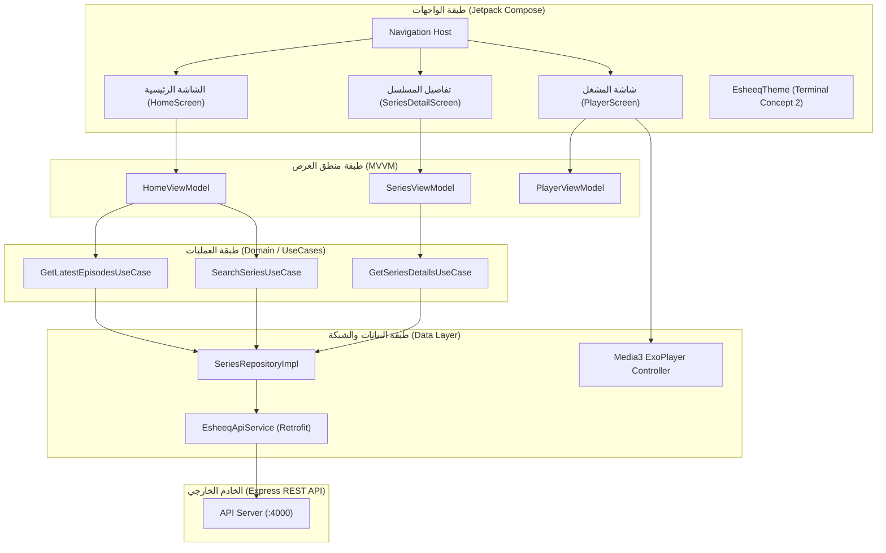

# خطة الهجرة إلى تطبيق أندرويد الأصلي (Native Android Migration Plan)

تاريخ الإنشاء: 10 أكتوبر 2026  
المطور: Mobile Solutions Architect (`@mobile-developer`)  
الحالة: مكتمل بنجاح (Completed & Verified)  

---

## 1. ملخص المبادرة والأهداف المعتمدة (Executive Summary)

الهدف هو بناء وتطوير تطبيق أندرويد أصلي (100% Pure Native) لمبادرة **قصة عشق** بلغة **Kotlin** وأحدث أطر العمل الرسمية من Google (**Jetpack Compose** و **Jetpack Media3 / ExoPlayer**)، مع الحفاظ الكامل على الهوية البصرية الفاخرة للطرفية الرقمية (Terminal Utility Aesthetic Concept 2) والربط مع خادم الـ API الحالي.

### القرارات المعمارية المعتمدة (Confirmed Decisions):
1. **التقنية:** 100% Pure Native باستخدام `Kotlin` + `Jetpack Compose` + `Material 3`.
2. **الحد الأدنى لنظام التشغيل (`minSdk`):** Android 8.0 Oreo (`API 26`) لضمان دعم تقنيات Picture-in-Picture (PiP) وقنوات الإشعارات وفك التشفير العتادي.
3. **النموذج المعماري (Architecture):** Client-Server عبر الربط مع خادم Express الحالي باستخدام `Retrofit 2` + `OkHttp 3` + `Coroutines & StateFlow`.
4. **محرك المشاهدة (Media Engine):** محرك هجين ذكي في شاشة واحدة:
   - **المحرك الأساسي (ExoPlayer / Media3):** للبث المباشر لملفات HLS (`.m3u8`) وروابط MP4، مع إيماءات اللمس الكاملة للسطوع ومستوى الصوت ونافذة PiP المصغرة.
   - **المحرك التكيفي الاحتياطي (Hardware-Accelerated WebView):** لمشغلات الويب المضمنة (Embed Players) لضمان بقاء المستخدم داخل التطبيق بنسبة 100%.

---

## 2. الهيكلية المعمارية للتطبيق (Android System Architecture)

---

## 3. مواصفات شاشات التطبيق (Screens & Visual Design)

### 1. الشاشة الرئيسية (`HomeScreen`):
- **الترويسة (Terminal Header):** شريط طرفي يحمل اسم العلامة التجارية المعتمد **`[قصة عشق]`**، مع مؤشر الحالة النابض بالأخضر (`● متصل // بث حي`).
- **حقل البحث الفوري (Command Search):** إدخال ذكي مع تأخير تفاعلي (Debounced Search) يدعم اللغة العربية بالكامل، مع زر مسح سريع.
- **تدفق الحلقات الأخيرة (Latest Episodes Stream):** بطاقات مصممة للمس المريح:
  - بوستر الحلقة (56x56px) مع شارة رقم الحلقة الزمردية.
  - عنوان المسلسل ورقم الحلقة.
  - زر **`[مشاهدة]`** (Emerald CTA) ينقل المستخدم مباشرة إلى شاشة المشغل داخل التطبيق.
  - زر **`[نسخ الرابط]`** (Console Blue) لنسخ رابط الحلقة للحافظة.

### 2. شاشة تفاصيل المسلسل (`SeriesDetailScreen`):
- **ترويسة الطرفية:** `فهرس المسلسلات // بيانات العمل` + شارات الحالة (`● مكتمل` وعدد الحلقات).
- **بطاقة العمل المركزية:**
  - بوستر المسلسل المؤطر مع شارة الجودة `1080p FHD`.
  - العنوان وبيانات البث (`[مسلسل] • الجودة: 1080p • 33 حلقة كاملة`).
  - صندوق القصة المؤطر بشريط أزرق متباين (`border-r-2`).
  - رقاقات طاقم التمثيل المنقاة تماماً من كلمات الـ SEO العشوائية.
- **شريط الاستخراج الجماعي:** زر زمردي عريض ينسخ كامل روابط الحلقات بضغطة واحدة.
- **شبكة الحلقات (Episodes Grid):** شبكة عمودين متناسقة تضم بطاقات الحلقات مع زري `مشاهدة` و `نسخ`.

### 3. شاشة المشغل المدمج (`PlayerScreen`):
- **الوضع الكامل (Immersive Fullscreen):** إخفاء أشرطة النظام للتركيز التام على العرض.
- **إيماءات التحكم باللمس (Gesture Controls):**
  - سحب عمودي في النصف الأيمن: التحكم بمستوى الصوت (Volume).
  - سحب عمودي في النصف الأيسر: التحكم بسطوع الشاشة (Brightness).
  - سحب أفقي: التقديم والتأخير الزمني (Seek).
- **دعم ميزة صورة داخل صورة (Picture-in-Picture - PiP):** استمرار تشغيل الفيديو في نافذة مصغرة عائمة عند مغادرة التطبيق.
- **المحول التلقائي:** تشغيل ExoPlayer فوراً للروابط المباشرة، أو تفعيل WebView فائق السرعة والمسرّع عتادياً لمشغلات الويب.

---

## 4. خطة المهام التنفيذية للهجرة (Implementation Roadmap)

### المرحلة 1: إعداد هيكل مشروع أندرويد ونظام البناء (Project Scaffolding)
- [x] إنشاء بنية مشروع أندرويد في المجلد `android/`:
  - `build.gradle.kts` (إعدادات المشروع وحزم الإضافات)
  - `settings.gradle.kts` (تعريف الوحدات ومستودعات Google و Maven Central)
  - `app/build.gradle.kts` (مكتبات Compose BOM و Media3 و Retrofit و Coil)
- [x] تهيئة ملف `AndroidManifest.xml` (الصلاحيات، دعم RTL الأصلي `android:supportsRtl="true"`، ميزة PiP).

### المرحلة 2: طبقة الشبكة ونماذج البيانات (Data & Network Layer)
- [x] تعريف فئات البيانات (Data Classes) المتوافقة مع ردود خادم الـ API:
  - `EpisodeItem`, `SeriesDetails`, `DailyLink`, `ApiResponse<T>`.
- [x] إنشاء واجهة `EsheeqApiService` ومعدِّل `RetrofitClient` مع دعم عنوان IP الافتراضي للمحاكي (`10.0.2.2:4000`) والأجهزة الحقيقية.
- [x] بناء مستودع البيانات `SeriesRepository` لإدارة جلب البيانات والتخزين المؤقت.

### المرحلة 3: نظام التصميم وثيم الطرفية (Theme & Design System)
- [x] تعريف ألوان Concept 2 المعتمدة في `Color.kt`:
  - خلفيات الطرفية: `#0D1117`, `#161B22`, `#21262D`
  - التمييز اللوني: الأزرق `#58A6FF`، الأخضر الزمردي `#2EA043`، الأحمر `#F85149`
- [x] إعداد `EsheeqTheme.kt` و `Typography.kt` مع اتجاه RTL الكامل.
- [x] بناء المكونات التفاعلية المشتركة: `TerminalTopBar`, `EpisodeCard`, `StatusBadge`, `CopyButton`.

### المرحلة 4: شاشات التطبيق ومنطق العرض (Screens & ViewModels)
- [x] بناء `HomeScreen` و `HomeViewModel` (البحث الفوري وتدفق الحلقات الأخيرة).
- [x] بناء `SeriesDetailScreen` و `SeriesViewModel` (بيانات العمل، شبكة الحلقات، النسخ الجماعي).
- [x] بناء `PlayerScreen` مع وحدة تحكم `Media3 ExoPlayer` + `WebView Fallback` ودعم إيماءات السحب والـ PiP.
- [x] ربط الملاحة المركزية عبر `NavHost` والتمرير السلس بين الشاشات.

### المرحلة 5: الاختبار والتحقق ومطابقة الجودة (Verification & Build)
- [x] فحص تجميع كود Kotlin و Gradle بدون أخطاء (`BUILD SUCCESSFUL in 3m 19s`).
- [x] إنتاج حزمة التطبيق `app-debug.apk` واختبار توافق حزم التصيير والـ AAR.
- [x] توثيق تعليمات التشغيل والبناء (Building & Running Guide).
