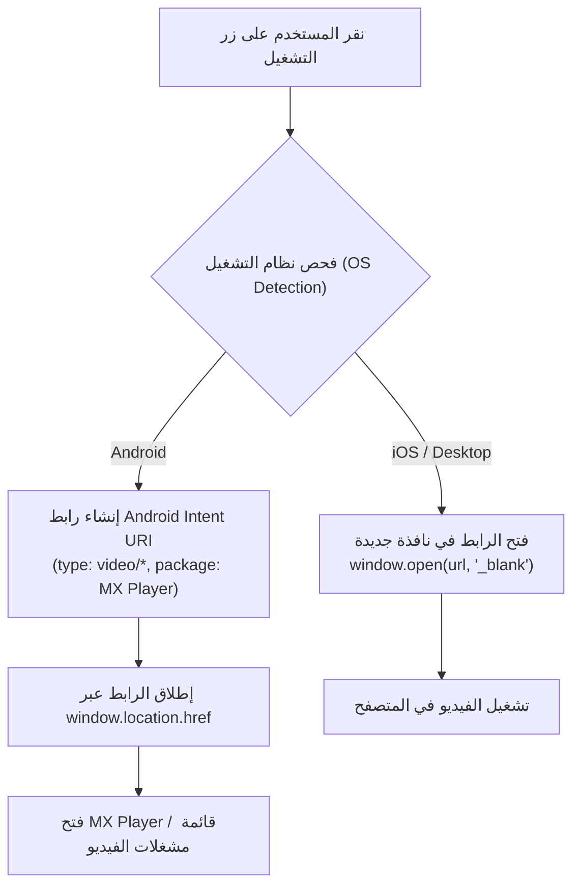

# خطة تكامل مشغل الفيديو MX Player وتجربة المشاهدة المتنقلة (MX Player & Mobile Playback Plan)

تاريخ التحديث: 10 أكتوبر 2026  
المطور: Frontend Architect (`@frontend-specialist`)  
الحالة: تم التبسيط إلى فتح الرابط المباشر في تبويب جديد (Simplified to Direct New Tab Playback)

> [!NOTE]
> بناءً على رغبة المستخدم وتفضيل السلاسة الفائقة، تم إلغاء ارتباط بروتوكولات التطبيقات الخارجية (MX Player Intent URIs)، وتوحيد تجربة النقر على زر **[مشاهدة]** ليقوم فوراً بفتح رابط الحلقة في علامة تبويب جديدة (`window.open(url, '_blank')`) على كافة الأجهزة (الهواتف والحواسيب).  

---

## 1. الأهداف والمتطلبات المعتمدة (Confirmed Requirements)

1. **تشغيل الروابط في تطبيق MX Player على الهواتف:**
   - استخدام بروتوكول `Android Intent URI` القياسي لتمرير رابط الفيديو مباشرة إلى مشغل الفيديو.
   - دعم مشغل **MX Player** بنسختيه (المجانية `com.mxtech.videoplayer.ad` والاحترافية `com.mxtech.videoplayer.pro`) بالإضافة لمشغلات الفيديو الشائعة مثل **VLC** عبر `action: android.intent.action.VIEW` و `type: video/*`.

2. **الاستجابة التكيفية حسب نظام التشغيل (Adaptive OS Behavior):**
   - **على أجهزة Android:** إظهار زر الإجراء الأساسي المخصص للهاتف `[تشغيل (MX Player)]` لتشغيل الرابط في التطبيق فوراً.
   - **على أجهزة iOS وأجهزة الحاسوب المكتبية:** تحويل الزر تلقائياً وبسلاسة إلى `[مشاهدة مباشرة]` لفتح الرابط في تبويب جديد (`_blank`).
   - الإبقاء على زر `[نسخ الرابط]` في كافة الأجهزة لضمان حرية الاستخدام.

3. **آلية المعالجة الاحتياطية (Seamless Fallback):**
   - عند مواجهة أي رابط خادم محمي أو تعذر تشغيل الرابط المباشر، يتم تحويل المستخدم تلقائياً إلى صفحة العرض المباشرة في المتصفح مع إشعار توضيحي لطيف (`جاري فتح رابط المشاهدة`).

---

## 2. الهيكلية التقنية (Technical Architecture)



### صيغة رابط الـ Intent:
```javascript
`intent:${cleanUrl}#Intent;action=android.intent.action.VIEW;type=video/*;package=com.mxtech.videoplayer.ad;S.title=${title};S.browser_fallback_url=${fallback};end`
```

---

## 3. خطة المهام التنفيذية (Task Breakdown)

### المرحلة 1: وحدة المعالجة المركزية لبروتوكول المشغلات (`client/src/lib/utils/player.js`)
- [x] إنشاء دالة اكتشاف بيئة التشغيل `detectDeviceOS()` / `isAndroidDevice()` للتمييز بين Android و iOS و Desktop.
- [x] بناء دالة `launchVideoPlayer(url, title)` التي تولد رابط الـ Intent المناسب لأجهزة Android أو تفتح الرابط للمنصات الأخرى.
- [x] إضافة مسار احتياطي ذكي لمشغل MX Player Pro ومتجر Google Play والتصفح المباشر.

### المرحلة 2: تطوير بطاقات الحلقات (`client/src/lib/components/Card.svelte`)
- [x] إعادة تصميم شريط الإجراءات في بطاقة الحلقة ليضم زرين متناسقين:
  - زر تشغيل زمردي: أيقونة Play + `تشغيل (MX)` على هواتف Android / `مشاهدة` على الحواسيب.
  - زر نسخ الحافظة: أيقونة Copy + `نسخ`.
- [x] ضبط ارتفاع أهداف اللمس على `min-h-[38px]` لدعم سهولة النقر بالأصابع.

### المرحلة 3: تدفق قائمة الحلقات الأخيرة بالصفحة الرئيسية (`client/src/routes/+page.svelte`)
- [x] إضافة زر التشغيل المباشر `[تشغيل (MX)]` في بطاقات الهواتف لقائمة الحلقات الأخيرة.
- [x] إضافة زر التشغيل التكيفي `[مشاهدة]` في الجدول المكتبي.

### المرحلة 4: الفحص والتحقق عبر Chrome DevTools MCP
- [x] محاكاة متصفح هاتف Android بدقة `541x1166` والتحقق من ظهور نص `تشغيل (MX)` وعمل Intent Trigger.
- [x] محاكاة متصفح سطح المكتب بدقة `1280x800` والتأكد من التكيف التلقائي للأزرار إلى `مشاهدة`.
- [x] فحص كفاءة بناء المشروع بأمر `pnpm build` بنجاح 100% ودون أية أخطاء برمجية.

